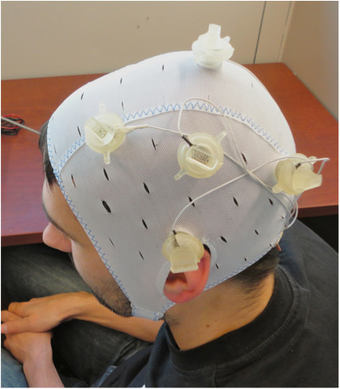

# High-Definition 电极布局：应用现状、证据、前景与选择建议

评估日期：2026-10-25（Asia/Shanghai）。重点：4×1 ring、连续环状回流及个体化多电极布局，分别讨论 HD-tDCS 与 HD-tACS。

本报告结合既有方法文献、2022 年综述及本轮检索到的 2025–2026 年临床研究。使用 PubMed 定向检索与 Europe PMC 全文 XML；不是完整系统综述、全球使用率调查或监管批准清单。下文的成熟度是综合判断，不是正式 GRADE 分级。逐篇核验层级见第 12 节。

## 1. 核心判断

**HD 已是可实施、有建模和生理学依据的研究工具；临床上出现了值得重视的阳性随机试验，但不能将“电场更聚焦”直接等同于“治疗普遍更好”。**

| 层面 | 本次评估 | 判断依据与边界 |
| --- | --- | --- |
| 建模与布局设计 | 较成熟，可作为科研平台 | 有高分辨率模型、4×1 方法和多电极优化；具体个体仍需验证 |
| 生理机制研究 | 已有可用证据 | 可改变 M1 兴奋性等指标，但变化不等于疾病治疗获益 |
| HD-tDCS 临床应用 | 已进入疾病特异性验证，尚不宜泛化 | 抑郁等方向有阳性 RCT；对长期维持、最优方案和直接优效的证据仍有限 |
| HD-tACS 临床应用 | 正在从机制研究向患者 RCT 推进 | 2026 年已有认知、帕金森病及意识障碍试验；不能一概说只有健康人实验，但仍需复制和长期验证 |
| 连续实体环形回流 | 有明确建模价值；本轮临床证据不足以独立评级 | 本轮直接核验的临床 HD 证据多涉及离散电极配置，不能外推给所有连续圆环方案 |
| 家庭与远程应用 | 可行性已有实例，推广条件仍需验证 | 要同时考虑接触、固定、依从性、人员支持与长期结果 |

对课题选型，建议把 HD 看成**增加空间控制与剂量设计自由度的工具**，而不是已经跨疾病证实更优的一类治疗。

## 2. HD、4×1 与 ring 到底指什么？

HD 描述的是提高空间选择性的一类设计思路，不是一种统一电极形状、固定设备或标准治疗方案。具体研究仍须报告电极尺寸、数量、材料、位置、电流与目标。

| 方案 | 含义 | 当前最需要避免的混淆 |
| --- | --- | --- |
| 4×1 ring | 一枚中心电极，周围四枚回流；通常由五个离散组件构成 | 不是一张连续环形电极；固定 EEG 定位也不自动等于个体化 |
| 中心盘＋连续圆环 | 独立中心电极和连续环状回流，属于不同边界条件 | 不能直接套用 4×1 的临床结果或电流分配 |
| 环形导体组件 | 单枚导体为环，装在凝胶与外壳中 | 导体环形不代表皮肤接触足迹中空，也不代表整个布局是 4×1 |
| 个体化 4×1 | 保持五电极结构，根据个体 MRI／靶点调整定位等 | 与任意候选位置、独立电流优化的多通道方案不同 |
| 优化多电极／多通道布局 | 在目标、非目标区和硬件约束下选择位置与电流 | 电极更多并不自动更有效；优化目标决定取舍 |

例如，Jog 等的 2025 年抑郁症试验采用五枚 **2×2 cm 电极**，周边距中心 5 cm，并以 MRI 和神经导航定位。[H06](#h06) 这说明 HD 也不能简单等同于“不到 1 cm² 的小圆盘”。

转载自 Villamar 等（2013，[H03](#h03)）原文 Figure 7，© 2013 Journal of Visualized Experiments，CC BY-NC-ND 3.0，未修改。该图仅示范一种系统，不能代表所有 HD 设备；[来源及许可](assets/electrode-shapes/SOURCES.md#villamar-fig07)。

## 3. 技术优势：已经获得哪些支持？

### 3.1 空间选择性：优势真实，但依赖具体比较

Datta 等的高分辨率头模型表明，在所比较的配置中，4×1 比传统大矩形垫产生更聚焦的电场。[H01](#h01) 对局部皮层功能的因果研究，减少广泛非目标区暴露具有明确价值。

但该比较同时改变大小、数量和回流位置，不是环形外观的独立优效证据。即使主电场集中于环内，也不能将环的周界当作脑内刺激的硬边界，不能假设周边电极和环外区域完全无作用。

### 3.2 可测量的生理效应：已有验证，不能代替临床结局

Kuo 等对 14 名健康参与者的研究直接比较传统与 4×1 HD-tDCS，两者都可改变 M1 兴奋性，HD 的后效峰值较延迟、持续较久。[H02](#h02)

这支持方案可调节神经生理，并不说明对抑郁、疼痛或认知下降也有相同比例的收益。MEP、EEG 或 fNIRS 变化属于机制或替代指标，不能替代功能、症状和生活质量结局。

### 3.3 多电极优化：提供取舍能力，不存在唯一“最优”

Ernie Extended 的结果说明，开放颈肩候选位置后，可在相同目标电场下改善部分聚焦性指标；同时，优先强度、优先聚焦或避开某些脑区，会得到不同配置。[H13](#h13)

因此，HD 的重要前景是把“希望改变哪个区域／网络、允许哪些非目标暴露”写成可计算约束，而不只是使用固定的五电极帽。模板模型的优化结果仍不是临床疗效或个体剂量的验证。

## 4. HD-tDCS 的应用现状：阳性与阴性证据并存

### 4.1 健康人的认知增强：没有稳定的普遍收益

Müller 等 2022 年工作记忆综述纳入 16 项研究，其中 11 项左前额叶研究进入 meta 分析。准确率效应 g=0.23、p=0.08；反应时效应经 trim-and-fill 后 g=0.03、p=0.75，均未达到统计显著。[H04](#h04)

Ostrowski 等对阴极 4×1 的语言／认知研究汇总 11 篇报告、77 个效应量，也未发现显著总体效应。[H05](#h05) 77 个效应量不是 77 名参与者，也不能与独立试验数量混同。

**判断：**HD 不是已证实可靠的通用认知增强方式。上述结果也不等于所有疾病人群、重复训练或其他参数均无效；它们限制的是“聚焦了就能稳定提高行为表现”的泛化。

### 4.2 抑郁症：已有值得重视的短期 RCT

Jog 等（2025，*JAMA Network Open*）是本次评估的重要临床依据。[H06](#h06)

| 项目 | 原文报告 |
| --- | --- |
| 设计 | 单中心、双盲、平行、sham 对照；71 人随机，active 40、sham 31 |
| 人群 | 当前抑郁发作，纳入 HAMD 14–23；排除难治性抑郁等人群 |
| 布局 | 五枚 2×2 cm 电极，中心位于个体化左 DLPFC 靶点，四周距中心 5 cm |
| 个体化 | 结构 MRI 与无框架立体定位神经导航 |
| 干预 | 12 个连续工作日，每次 20 分钟；active 为 2 mA |
| 主要结果 | HAMD 改变量 active −7.8、sham −5.6，组间差 −2.2 分；p=0.04；Cohen d=−0.50，95% CI −0.99 至 −0.01 |
| 随访 | 没有维持刺激；作者报告 2、4 周探索性随访未显著 |

**可以得出的结论：**该个体化 HD-tDCS 方案在所纳入人群中具有短期抗抑郁潜力，观察到中等效应量，但置信区间也包含很小的收益。

**不能得出的结论：**

- 它优于传统 tDCS、药物或心理治疗：试验没有这些直接对照，不能通过跨试验的治疗时长或效应量完成优效判断。
- MRI 个体化本身增效：没有非个体化 HD 对照，作者明确承认未验证这一点。
- 效果已证实持续 4 周：探索性随访未显著，维持方案仍需研究。
- 适用于难治性抑郁或所有临床人群：入选标准不支持这种外推。

另需注意，sham 在升降电流后仍输出 0.065 mA；作者指出它可能并非完全生理惰性。这不是用来否定结果，而是后续试验需要进一步澄清的对照设计因素。

### 4.3 成瘾、康复及其他疾病：已有信号，证据厚度不同

Saha 等 2026 年针对物质使用障碍渴求的 meta 分析纳入 3 项 RCT、138 人，报告 g=−0.596，95% CI −1.039 至 −0.152。[H10](#h10) 这是有希望的症状信号，但结局是渴求，不能等同于戒断成功率、复吸减少或长期康复。

语言、卒中、疼痛、耳鸣等也是已有研究覆盖的方向。[H11](#h11) 不能因为应用领域很多，就认为每个方向都已完成大样本、直接优效和长期验证。本报告不对所有疾病进行统一疗效排名。

## 5. HD-tACS：已经进入患者研究，但机制与疗效须分别评估

HD-tACS 增加了频率、相位与振荡靶点的设计空间，也增加了感觉匹配、相位解释和刺激伪迹处理的要求。不能把 HD-tDCS 的疗效及剂量直接移用到 HD-tACS。

本轮核验到的代表性患者研究：

| 研究 | 设计、实际布局或核验范围 | 报告的结果 | 仍缺什么 |
| --- | --- | --- | --- |
| Gao 等，2026，卒中后认知障碍 [H07](#h07) | 全文：单中心、单盲；36 人入组、34 人完成；个体 theta、固定 5 Hz、sham 三组；F3 中心，FP1/Fz/C3/F7 回流 | 个体 theta 组 MoCA 变化优于 sham；部分其他结局只有组内改善 | 大样本、前瞻性注册验证与长期随访；不能由组内变化推断治疗间差异 |
| Dong 等，2026，帕金森病执行功能 [H08](#h08) | 全文：28 人随机；Fz 中心，F1/F2/FCz/AFz 四个回流，6 Hz，共 10 次 | 部分执行功能指标优于 sham，但 DST、部分言语流畅性及部分 SST 指标未见刺激特异效应 | 长期效果及电生理机制；fNIRS 任务与行为任务不完全对应 |
| Hu 等，2026，持续性意识障碍 [H09](#h09) | 摘要：60 人、四组，40 Hz 与 4 Hz 及各自 sham；尚未核对具体电极位置 | 报告 40 Hz 的 CRS-R 改善、连接变化及随访信号 | 完整方法、随访分母、缺失数据和独立复制；不能仅凭 HD 名称归为标准 4×1 |

### 5.1 对证据的具体限制

Gao 研究的全文说明 36 人入组、2 人退出，最终三组为 11、11、12 人；摘要中的 34 人不宜直接写成完整随机样本数。研究为回顾性注册，且没有长期随访。它比较的是频率策略，**不是 4×1 对传统双电极的优效试验**；个体频率组相对 sham 显著，也不能单独证明它优于固定频率组。[H07](#h07)

Dong 研究按个体感觉阈值调整电流，真实组平均约 0.40 mA 峰峰值；这也提示不能仅凭不同论文的“mA”数字推断剂量强弱。作者没有同步电生理证据来确认行为效果必然由 theta 节律调节介导。[H08](#h08)

Hu 研究纸刊日期为 2026 年 11 月，但 PubMed 记录其在线发表为 2026-10-03，因此属于本评估日期前已在线发表的证据。本报告不将摘要中的随访比例转成绝对人数，也不把尚未核对的布局归类为连续环形或 4×1。[H09](#h09)

**判断：**HD-tACS 已不只是技术设想，但现有患者试验不能证明所有频率、靶点和疾病都适用，更不能证明 HD 配置本身优于传统配置。

### 5.2 为什么“40 Hz＋HD”仍不等于精准 gamma 治疗？

- 头皮电流频率不等于已证实目标神经元发生相同频率的有效 entrainment。
- 环内电场存在不代表只调节环内脑区，也不意味着脑区相位与设备通道相位相同。
- 皮肤、周围神经及视觉感觉可能参与效应，需要合适的主动对照；相关机制线索见 [H14](#h14)。
- 刺激中 EEG 可能受到强伪迹；刺激后的 EEG 改变又不能直接证明刺激中的相位锁定。需要与实际测量时间及伪迹处理相匹配的结论。

## 6. 4×1、连续 ring 与优化多通道，如何选择？

| 方案 | 优先考虑的用途 | 优势 | 代价或局限 |
| --- | --- | --- | --- |
| 固定 4×1 | 单个浅表皮层靶点、复现既有方案、机制试验 | 方法较明确，五电极即可实施，易于描述和比较 | 固定头皮点未必匹配个体脑区；环半径、接触和回流影响剂量 |
| 个体化 4×1 | 需要将局部靶点与个体 MRI 对齐的研究 | 保留相对简单结构并提高解剖定位一致性 | MRI／导航成本；是否增效要用非个体化对照检验 |
| 中心盘＋连续环 | 具有明确几何目的的专门方案与建模比较 | 理想模型可形成环绕回流 | 接触面积、内外边缘与几何范围不同，不能套用 4×1 的临床证据 |
| 优化多通道 | 分布式网络、避开非目标区、场方向或剂量匹配 | 可将多个目标和硬件约束写入优化 | 需要独立通道、完整模型、可实现的布局及稳健性验证 |

对理想环绕配置，缩小中心与回流距离可能改善浅层空间约束，同时增加近距离分流并牺牲深部场强；扩大环也不必然同时提高强度与聚焦性。实际选择应建模，而非使用固定“最佳半径”。[H03](#h03)

4×1 的中心与四周电流要满足整个回路的守恒，四支路是否均分需核查实际硬件。多通道 tACS 还应在每个时间点满足电流约束；不能将一个普通 4×1 方案解释成两个脑区独立相位控制。

## 7. 应用瓶颈：还差哪些关键证据？

### 7.1 缺少足够的直接优效比较

至少应分开比较：HD vs sham、HD vs 传统布局、个体化 vs 固定布局。三个问题不能通过同一项 sham 试验全部解决。

其中“相同外加电流”与“目标区电场匹配”的比较也不同：前者评价常规实施方式，后者更接近检查空间选择性是否带来额外收益。若剂量、疗程、联合训练和感觉都不同，应称为整体方案比较。

### 7.2 更聚焦不一定更符合疾病的网络目标

疾病可能涉及分布式网络。把电场限制在一个很小的皮层 ROI，可能减少不希望的暴露，也可能丢失有用的网络调节。适合的目标应来自机制和临床问题，不应由“最小的热点”单独决定。

个体脑沟回、脑脊液、萎缩或卒中病灶也会改变剂量。更高的模型分辨率并不消除组织电导率和神经响应的不确定性。

### 7.3 可实施性与可重复性

小型组件的接触、凝胶外溢、头发和固定会影响有效面积；五个电极通常比两个电极增加接触检查环节，但具体耗时取决于系统，不能用固定分钟数概括。[H03](#h03)

设备显示的接触质量单位不总能换算成 kΩ；还需检查逐通道实际电流、输出电压余量、相位及波形。更多电极不等于更少感觉，也不自动提高盲法。

### 7.4 耐受性总体较好，但不能以此替代疗效证据

Carther-Krone 与 Ko 的 2025 年综述显示，HD-tDCS 文献多报告轻度、短暂刺痒、灼热等感觉，但不良事件评估与报告并不统一。[H11](#h11)

“严重程度较高的主观感觉”不等于监管定义的 serious adverse event。没有报告也不等于经过系统检查后确认没有；综述中“多少研究报告某感觉”也不是患者发生率。既有耐受性结果不能无条件推广到不同组件、频率、长期疗程或特殊人群。

## 8. 家庭与远程 HD：有实例，但仍需系统支持

Massonet 等的 HIT-CRAD 研究共随机 54 人至三个训练组，其中一个组联合 HD-tDCS，另有 sham 组；该论文报告居家训练及刺激的可行性与依从性，整体依从性保持在 75% 以上。[H12](#h12)

这里不能把 54 人都写成接受真实 HD，也不能将可行性论文解释为 HD 对吞咽功能已证明优于所有其他训练。它支持的是**在特定组织与支持条件下，居家实施可以成立**。

未来的关键是接触质量检查、可靠固定、依从性记录、远程支持和重复操作能力，而不仅是设备小型化。是否降低总成本，需要同时计算设备、耗材、准备、MRI／导航与人员支持，本轮未找到足以作通用成本效益结论的数据。

## 9. 前景：哪些方向更值得投入？

| 方向 | 本报告判断 | 需要的验证 |
| --- | --- | --- |
| 按目标区实际电场设计剂量 | 优先级高 | 不同个体剂量一致性及与临床结局的关系 |
| 个体 MRI／病灶与网络靶点结合 | 值得投入，增效尚需直接验证 | 固定 HD 对照、跨中心复现、资源成本 |
| 不确定性下的稳健多通道优化 | 技术价值高 | 电极偏移、接触及电导率变化下仍可实现的收益 |
| 与认知训练、康复或心理治疗结合 | 有机制依据与应用潜力 | 因子设计，区分刺激、训练与交互作用 |
| 个体频率／脑状态引导的 HD-tACS | 值得研究，现有信号仍早期 | 预注册、合适频率对照、真实靶点参与和长期收益 |
| EEG 闭环相位刺激 | 有前景，验证难度更高 | 在线伪迹抑制、延迟、相位估计和独立行为证据 |
| 仅增加通道数或把方案标为 HD | 单独价值有限 | 必须证明具体的剂量、机制或临床优势 |

最有价值的升级，是从“电极放得更细”走向“目标明确、剂量可量化、实际输出可验证、临床收益可复制”。目前不能把这一方向的合理性当作其全部环节已经完成验证。

## 10. 对当前楔前叶与 DLPFC 研究的建议

### DLPFC

如果目标是检验局部调节机制，4×1 是值得纳入的候选方案；若是抑郁治疗研究，可将 Jog 等作为特定原型，但要保持人群、定位与疗程的可比性，不能只复制“2 mA＋五个电极”。

需要论证个体化价值时，应设置固定 HD 对照；需要论证 HD 优势时，应设置传统布局对照，不能仅比较 sham。

### 楔前叶／Pz

楔前叶主要位于半球内侧，固定的小半径 4×1 不一定能在更聚焦的同时维持所需目标区剂量。不能直接用 4×1 替换 Pz—三角肌，并假设二者只是“精度不同”。

建议先在同一合适模型中比较 Pz—三角肌、候选 4×1 和可实现的优化多通道方案，报告楔前叶及邻近顶枕区、脑干／脊髓等暴露，明确电场方向与目标剂量匹配方式。模型和感觉控制足以支持选择后，再设计功能与临床验证。

### 连续 ring

将其作为独立候选布局研究，记录内外径、实际接触足迹、接触层及中心—环间隙。除非有直接证据，不应将离散 4×1 的作用、耐受性或临床结果等同于连续环形回流。

## 11. 建议的证据与实验路线

1. 确定问题：局部机制、网络调节、疾病治疗，还是复现已有方案。
2. 建模筛选：固定 4×1、个体化／优化候选、传统参考方案，在明确电流和硬件约束下比较。
3. 工程验证：实际接触与输出、定位误差、可重复安装、感觉及盲法。
4. 靶点验证：尽量使用与机制相符且能控制伪迹的生理测量，避免只看单个 EEG 功率或全脑电场峰值。
5. 临床验证：预注册主要终点、合理样本量和随访；按问题设置 sham、传统或非个体化对照。
6. 转化验证：维护疗程、功能结局、家庭支持需求、跨中心效果及成本。

监管与临床可用性应按具体设备、地区、适应症与波形核验；设备可购买、研究使用或传统 tDCS 的某项资格，均不能自动赋予所有 HD 布局同样地位。本报告没有作全球监管状态审计。

## 12. 主要文献与核验层级

H01–H03、H13 复用本仓库既有核验；H14 沿用文献线索，本轮未重新核对。本轮新增 H04–H12 的书目与摘要核查，并读取 H06–H08、H11 全文。没有完成每个方向的系统检索或重新合并效应量。

**H01｜模型聚焦性。** Datta A, Bansal V, Diaz J, et al. *Gyri-precise head model of transcranial direct current stimulation: improved spatial focality using a ring electrode versus conventional rectangular pad.* Brain Stimulation. 2009;2(4):201–207,207.e1. [DOI](https://doi.org/10.1016/j.brs.2009.03.005)；[PMID 20648973](https://pubmed.ncbi.nlm.nih.gov/20648973/)。核验：完整摘要。是配置比较，不是等面积单纯形状试验。

**H02｜健康人直接生理比较。** Kuo HI, Bikson M, Datta A, et al. *Comparing cortical plasticity induced by conventional and high-definition 4×1 ring tDCS: a neurophysiological study.* Brain Stimulation. 2013;6(4):644–648. [DOI](https://doi.org/10.1016/j.brs.2012.09.010)；[PMID 23149292](https://pubmed.ncbi.nlm.nih.gov/23149292/)。核验：完整摘要。不能代替患者临床结局。

**H03｜4×1 组件与方法。** Villamar MF, Volz MS, Bikson M, et al. *Technique and considerations in the use of 4×1 ring high-definition transcranial direct current stimulation (HD-tDCS).* J Vis Exp. 2013;(77):e50309. [DOI](https://doi.org/10.3791/50309)；[全文](https://pmc.ncbi.nlm.nih.gov/articles/PMC3735368/)。核验：全文 XML；图片许可另见来源记录。

**H04｜工作记忆 meta 分析。** Müller D, Habel U, Brodkin ES, Weidler C. *High-definition transcranial direct current stimulation (HD-tDCS) for the enhancement of working memory—A systematic review and meta-analysis of healthy adults.* Brain Stimulation. 2022;15(6):1475–1485. [DOI](https://doi.org/10.1016/j.brs.2022.11.001)；[PMID 36371009](https://pubmed.ncbi.nlm.nih.gov/36371009/)。核验：完整摘要；16 篇综述、11 篇左 PFC 分析，不能当作所有疾病人群的无效证据。

**H05｜阴极 4×1 的认知／语言 meta 分析。** Ostrowski J, Svaldi J, Schroeder PA. *More focal, less heterogeneous? Multi-level meta-analysis of cathodal high-definition transcranial direct current stimulation effects on language and cognition.* J Neural Transm. 2022;129(7):861–878. [DOI](https://doi.org/10.1007/s00702-022-02507-3)；[PMID 35585206](https://pubmed.ncbi.nlm.nih.gov/35585206/)。核验：完整摘要。

**H06｜个体化 HD-tDCS 抑郁症 RCT。** Jog MA, Norris V, Pfeiffer P, et al. *Personalized High-Definition Transcranial Direct Current Stimulation for the Treatment of Depression: A Randomized Clinical Trial.* JAMA Network Open. 2025;8(9):e2531189. [DOI](https://doi.org/10.1001/jamanetworkopen.2025.31189)；[PMID 40932717](https://pubmed.ncbi.nlm.nih.gov/40932717/)；[全文 XML](https://www.ebi.ac.uk/europepmc/webservices/rest/PMC12426800/fullTextXML)。核验：全文，重点检查配置、主要终点及作者局限；没有传统或非个体化直接对照。

**H07｜个体 theta HD-tACS 与卒中后认知。** Gao Y, Duan F, Han M, et al. *Effects of individualized Theta frequency high-definition transcranial alternating current stimulation on cognitive function in patients with post-stroke cognitive impairment: a randomized, single-blinded, controlled trial.* NeuroImage: Clinical. 2026;51:104048. [DOI](https://doi.org/10.1016/j.nicl.2026.104048)；[PMID 42594698](https://pubmed.ncbi.nlm.nih.gov/42594698/)；[全文 XML](https://www.ebi.ac.uk/europepmc/webservices/rest/PMC13495618/fullTextXML)。核验：全文；36 入组、34 完成，摘要与正文对人数的概括不同，应保留区别。

**H08｜帕金森病执行功能。** Dong K, Zhao Y, Zhu X, et al. *Theta tACS Over the Medial Frontal Cortex Modulates Executive Function in Parkinson's Disease: A Randomized, Sham-Controlled Study.* CNS Neuroscience & Therapeutics. 2026;32(7):e71055. [DOI](https://doi.org/10.1002/cns.71055)；[PMID 42499269](https://pubmed.ncbi.nlm.nih.gov/42499269/)；[全文 XML](https://www.ebi.ac.uk/europepmc/webservices/rest/PMC13401142/fullTextXML)。核验：全文；未见长期随访与直接 theta 电生理机制验证。

**H09｜意识障碍 HD-tACS RCT。** Hu J, Mou C, Jiang X, et al. *HD-tACS at 40 Hz improves consciousness and brain connectivity in prolonged disorders of consciousness: a randomized sham-controlled clinical trial.* NeuroImage. 2026;341:122274；在线发表 2026-10-03. [DOI](https://doi.org/10.1016/j.neuroimage.2026.122274)；[PMID 42829016](https://pubmed.ncbi.nlm.nih.gov/42829016/)。核验：完整摘要；具体布局、随访分母及缺失数据待全文核查。

**H10｜物质使用障碍渴求 meta 分析。** Saha P, Muhammed JK, Sevda P, Verma R, Sarkar S. *Efficacy of high-definition transcranial direct current stimulation on craving in substance use disorders: a systematic review and meta-analysis.* J Addict Dis. 2026;44(4):501–510. [DOI](https://doi.org/10.1080/10550887.2026.2658662)；[PMID 42000300](https://pubmed.ncbi.nlm.nih.gov/42000300/)。核验：完整摘要；3 项 RCT、138 人，结局为渴求而非长期复吸。

**H11｜耐受性与不良事件报告综述。** Carther-Krone T, Ko JH. *A review on the reporting and assessment of adverse effects associated with high-definition transcranial direct current stimulation.* Front Hum Neurosci. 2025;19:1682771. [DOI](https://doi.org/10.3389/fnhum.2025.1682771)；[PMID 41473909](https://pubmed.ncbi.nlm.nih.gov/41473909/)；[全文 XML](https://www.ebi.ac.uk/europepmc/webservices/rest/PMC12745649/fullTextXML)。核验：全文；涉及疗效与直接比较的判断，以原始试验设计为准，不从综述的概括替代直接对照。

**H12｜家庭实施可行性。** Massonet H, Goeleven A, Nuyts S, et al. *Feasibility and Adherence to Home-Based Intensive Treatment Programs for Chronic Radiation-Associated Dysphagia in Head and Neck Cancer Survivors—The HIT-CRAD Trial.* Head & Neck. 2026;48(5):1340–1350. [DOI](https://doi.org/10.1002/hed.70136)；[PMID 41420436](https://pubmed.ncbi.nlm.nih.gov/41420436/)。核验：完整摘要；54 人为三组总数，不是全部接受真实 HD。

**H13｜扩展模型与优化。** Van Hoornweder S, Cappozzo V, De Herde L, et al. *Head and shoulders—The impact of an extended head model on the simulation and optimization of transcranial electric stimulation.* Imaging Neuroscience. 2024;2:imag-2-00379. [DOI](https://doi.org/10.1162/imag_a_00379)；[全文](https://pmc.ncbi.nlm.nih.gov/articles/PMC12315774/)；[本仓库精读](ernie-extended-paper-analysis.zh-CN.md)。核验：全文；单人模型，不能代替跨个体临床验证。

**H14｜周围神经机制线索。** Asamoah B, Khatoun A, Mc Laughlin M. *tACS motor system effects can be caused by transcutaneous stimulation of peripheral nerves.* Nature Communications. 2019. [DOI](https://doi.org/10.1038/s41467-018-08183-w)。核验状态：沿用既有文献线索，本轮未重查全文；不能将其概括为所有 tACS 效果均为外周来源。

相关笔记：[电极形状、组件与选择依据](tes-electrode-shapes.zh-CN.md)；[头部—肩部回流](tacs-head-shoulder-return.zh-CN.md)。
